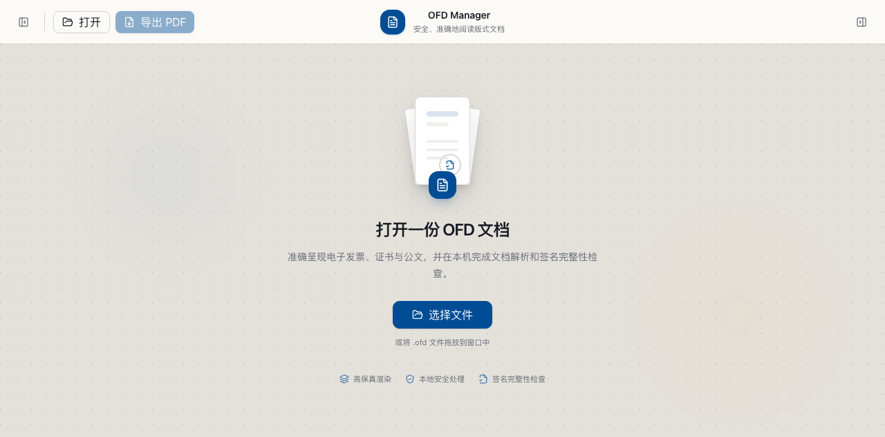

# OFD Manager

A cross-platform viewer and toolkit for **OFD** files — *Open Fixed-layout
Document* (GB/T 33190-2016), China's national fixed-layout document format used
for VAT e-invoices, e-tickets, certificates, and official documents.

[中文](README.md)

The core idea: implement the hard part — faithful OFD **parsing and rendering** —
once in portable Rust, then ship it everywhere (desktop, mobile, web). Today the
Rust core library, command-line tool, and Tauri desktop app are working and
render real-world documents with high fidelity.

> Status: **early but functional.** The rendering engine handles real invoices,
> air tickets, and certificates faithfully (validated against reference renders).
> The desktop app supports opening, rendering, navigating, verifying, and
> exporting OFD documents.

## Components

This repository contains three main parts:

- **Rust core library** (`crates/ofd-core`): parses OFD containers and renders
  pages to bitmaps. It is designed to remain portable and independent of UI or
  filesystem concerns.
- **CLI implementation** (`crates/ofd-cli`): provides `render` and `verify`
  commands for rendering pages and checking signature file-digest integrity.
- **Desktop app** (`apps/desktop`): a cross-platform Tauri v2 application built
  with React and TypeScript, with thumbnails, outlines, metadata, signature
  verification, and image-based PDF export.

## macOS preview



## What works

- **Rendering** of pages to images: text (with embedded fonts), vector paths,
  raster images, layers, templates, clipping, transparency.
- **Fonts**: uses the document's embedded fonts (TrueType, OpenType/CFF, and even
  bare-CFF); substitutes deterministic CJK fonts when a font isn't embedded, so
  output is consistent across machines. Correct CJK layout via OFD's explicit
  per-glyph positioning, including **vertical text**.
- **Electronic seals** (电子签章, GB/T 38540): renders both raster seals and vector
  seals (an embedded OFD stamp), decoded from the SES structure.
- **JBIG2 images**: invoice QR codes and scanned bilevel images.
- **Signatures**: models digital signatures and verifies **file-digest integrity**
  (SM3/SHA-256/MD5) — detects whether any protected file was tampered with.
- **Export**: render any page to PNG at any DPI.
- **macOS Quick Look**: native Finder spacebar preview and Finder thumbnails for
  `.ofd` files, shipped as two Quick Look extensions inside the desktop app
  (extensions require macOS 12+).

Known gaps: full cryptographic signature *authenticity* (SM2 + certificate chain),
CCITT/G4 images, and a few advanced annotation blend modes are not implemented yet.

## Quick start

Requirements: a recent Rust toolchain.

```bash
# Render the first page of an OFD to a 300-DPI PNG
cargo run -p ofd-cli -- render invoice.ofd out.png --dpi 300

# Render a specific page, or crop a region (pixels) for a close look
cargo run -p ofd-cli -- render doc.ofd p2.png --dpi 300 --page 1
cargo run -p ofd-cli -- render doc.ofd crop.png --dpi 300 --region 0,0,800,400

# Check a signed document's integrity (are the protected files unmodified?)
cargo run -p ofd-cli -- verify invoice.ofd
```

For pixel-consistent CJK rendering of documents that don't embed their fonts,
fetch the bundled fallback fonts once (optional; ~47 MB, not committed):

```bash
scripts/fetch-fonts.sh
```

## Quick Look on macOS

The desktop app bundles two macOS Quick Look extensions (`.appex`):

- **Preview** (`OFDQuickLookPreview`): select an `.ofd` file in Finder and press
  Space for a native multi-page preview (first 32 pages at 144 DPI by default).
- **Thumbnail** (`OFDQuickLookThumbnail`): first-page thumbnails in Finder icon
  view and the Quick Look list.

| Item | Notes |
| --- | --- |
| System requirement | Extensions need macOS 12+; the app itself is unchanged |
| Supported UTIs | `public.ofd` (declared by macOS 27.2+) and `com.ofdmanager.ofd` (exported by the app; fallback on older macOS) |
| Install | Put `OFD Manager.app` in `/Applications` (or another LaunchServices-indexed location) and launch it once so the extensions get registered |
| Verify | Select an `.ofd` in Finder and press Space; or use `qlmanage -p invoice.ofd` / `qlmanage -x -t -s 512 -o out invoice.ofd` |

macOS 27.2+ ships its own OFD Quick Look extension (`com.apple.OFDPreview`). When
both the system and the app extension are enabled, the system picks one; adjust it in
**System Settings > General > Login Items & Extensions**, or with `pluginkit`:

```bash
# Prefer the OFD Manager preview extension; restore the system one with
# pluginkit -e default -i com.apple.OFDPreview
pluginkit -e use -i com.ofdmanager.desktop.quicklook.preview
pluginkit -e ignore -i com.apple.OFDPreview
```

See [`docs/quicklook.md`](docs/quicklook.md) for the architecture, build and
verification steps.

## Project layout

```text
crates/
  ofd-core/       Portable rendering core (parse → model → bitmap). No I/O or UI.
  ofd-cli/        Command-line front-end: render, verify.
  ofd-quicklook/  C-ABI static library backing the macOS Quick Look extensions.
apps/desktop/     Tauri v2 + React + TypeScript desktop viewer.
  macos/quicklook/  macOS Quick Look preview/thumbnail extensions (Swift + .appex).
fixtures/         Sample OFD files and reference page images for regression tests.
docs/             The GB/T 33190 standard and related documents.
scripts/          Helper scripts (e.g. fetch-fonts.sh, build-quicklook.sh, install-hooks.sh).
```

The core is intentionally pure (bytes in, image out, no filesystem or threads of
its own) so the same code can later compile to WebAssembly for an in-browser
viewer and link into native desktop/mobile apps.

## Building and testing

```bash
cargo build --workspace
cargo test  --workspace
```

The test suite includes a **golden-image regression**: every sample renders, and
pages with a reference image are compared perceptually to catch layout, color, or
font regressions.

The macOS Quick Look extensions can be built and self-checked on their own
(other platforms skip the script):

```bash
scripts/build-quicklook.sh --check
```

A full app build runs the extension build automatically and embeds the appexes in
`Contents/PlugIns`:

```bash
cd apps/desktop && npx tauri build --bundles app
```

## Git commit checks

Enable the shared pre-commit hook once per clone:

```bash
scripts/install-hooks.sh
```

The hook checks staged whitespace, then runs the CI-equivalent Rust checks for Rust changes and the desktop lint, test, and build checks for frontend changes.

## Roadmap

- Continue improving the desktop app (Tauri v2 + React)
- Improve OFD → PDF export
- Android / iOS apps and a pure-WebAssembly web viewer
- Full signature authenticity (SM2 signature + certificate validation)
- Local file management (browse, recents, favorites)

## Standards

- **GB/T 33190-2016** — OFD document format (parsing & rendering target)
- **GB/T 38540 / GM/T 0031** — electronic seal (SES) structure
- **GB/T 32905** — SM3 hash (signature digest verification)

## A note on fonts

Documents that embed their fonts render exactly. For documents that only *name* a
font (e.g. 宋体/SimSun) without embedding it, the result depends on available
fonts; the bundled fallback set (Windows core CJK fonts, fetched via the script)
gives deterministic, cross-platform output. Those fonts are not redistributed in
this repository.
